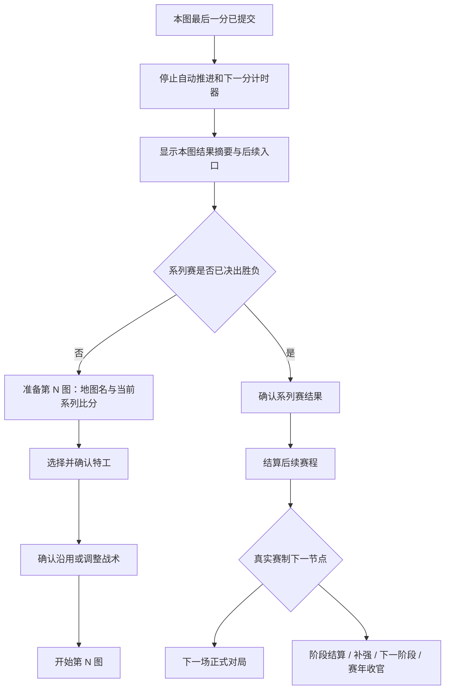

# 移动端布局、比赛推进与视觉改版 Implementation Plan

> 执行说明：本文件是待实施方案。后续可使用 executing-plans 按任务逐项落实；本轮不修改游戏实现、不发布版本。

**Goal:** 在 vivo 手机桌面图标启动、竖屏场景中保证导航与存档可达，地图结束后有明确后续流程，自动推进可随时停止，并建立统一视觉风格。

**Architecture:** 保留现有比赛规则、Worker、存档事务与正式前端地址。收敛应用外壳的尺寸规则；由一个比赛界面状态模型生成状态文字、主操作和控件权限，减少各视图分别判断造成的不一致。视觉改版以 Aurora Glass 为参考，针对游戏的可读性与持续刷新做适配。

**Tech Stack:** 原生 HTML/CSS/JavaScript、Web Worker、IndexedDB、PWA、Node test runner。新增文档中的文件名为计划项，不表示已有实现。

---

## 1. 反馈范围与证据边界

用户确认环境：**vivo 手机、桌面图标启动、竖屏、页头 v0.8**。尚未取得具体机型、系统/浏览器内核版本以及该设备的有效视口数据；不能把手机型号换算成猜测的 CSS 像素尺寸。

本轮基线：`5f96239`，v0.8。v0.6/v0.7 曾实施过稳定性与旅程改进，不能把旧建议再次描述成完全未实现，也不能用旧验收覆盖用户此次反馈。

| 用户问题 | 本轮核对 | 尚待确认 |
| --- | --- | --- |
| 底部 Tab 消失、设置存档状态被遮挡 | 当前根页显示 Tab，子页由代码主动隐藏；设置存档状态被追加在危险操作之后。应用仍加载多份历史尺寸样式，末尾再改为 flex | vivo 实机是视口裁切、滚动区异常、布局规则冲突，还是主导航隐藏策略叠加的问题 |
| 一张地图结束后无法继续 | 代码存在本图结算→下一图特工→系列赛结算，但地图结束只停止播放并刷新；关键推进依赖底部 dock | 用户现场是否 dock 不可见，或终局/回放/旧档路由状态未正确切换 |
| 顶部重复提示、显隐抖动 | `session-status` 与 `round-busy` 都使用 `statusText()`；后者随计算显隐。另有持久保存条和操作回执 | vivo 上各条高度与换行对抖动的具体贡献 |
| 自动推进难以操作 | 计算时 `setRoundBusy()` 禁用大部分 action；点击分发又拦截操作，包含停止自动推进。普通自动间隔至少3.6秒，快速模式仅80ms | 真机计算耗时与玩家手动介入时的实际体验 |

补充观察：本轮独立测试库中，内置浏览器有效视口390×844时，征战根页 Tab 位于 y≈779–844；设置页滚动后存档状态可见。设置页仍显示“等待教练确认”的比赛状态，说明提示缺少页面范围限制。**这不是 vivo 桌面启动场景的复现或通过结论。**

优先级：布局可达性与地图结束后续为发布阻断项；提示抖动与停止控制随后同轮处理；视觉在功能骨架稳定后统一应用。

## 2. 布局：按可用视口排版，导航不再依赖页面长度

### 2.1 固定的页面结构

```text
安全区 + 页头                 返回 / 标题 / 设置
比赛状态区（仅比赛页）         始终保留位置，只更新内容
可滚动正文                   唯一主滚动区
当前流程操作区（按需）         开始 / 暂停 / 查看结算 / 下一图
战队 · 征战 · 档案             主导航
底部安全区                   只计一次
```

方案决策：常规页面及比赛页保留三项主导航；流程主按钮是导航上方的独立操作区。设置和资料详情也保留导航，避免用户把“进入子页”误认为丢失出口。仅全屏沙盘和模态弹窗暂时覆盖导航，必须有显眼关闭按钮和可用的系统返回。

点击主导航时：停止后续自动推进；若当前分正在计算，完成这一分的确定性计算并保存，不再启动下一分。保留当前比赛位置，返回征战后可以继续。战术草案按现有规则明确撤销或应用，不静默丢失。

### 2.2 尺寸约束

- 保留 flex 外壳，但把高度、滚动、底栏职责集中在一个样式文件；移除被替代的正式入口尺寸声明，避免继续往样式末尾叠加补丁。历史兼容资源不擅自删除。
- 手机以实际可用视口为高度来源。先验证 `100dvh`；不支持时使用兼容回退。仅在测得桌面启动内核的布局视口与可视视口不一致时，再使用 `visualViewport` 高度回退，并记录 resize、键盘及方向变化。
- 不用 `transform: scale()` 或 `zoom` 整体缩小390×844模板，不禁用用户缩放，不用设备物理分辨率计算界面尺寸。
- 正文 `flex:1; min-height:0; min-width:0; overflow:auto`；页头、状态区、动作区和导航不被内容撑大或挤出屏幕。高层容器裁切前必须确认其内部有真正可用的滚动区。
- 页头基准56px，主导航内容区56–64px，触控目标至少44×44px；流程操作区约64–72px。安全区统一由壳层或最下方容器承担一次。
- 矮屏优先缩小沙盘和折叠次要说明；不缩小核心按钮，不隐藏导航。大字模式允许按钮两行和正文重排。
- 横屏的沙盘与信息可左右排布；桌面最大内容宽度约1120px。不同设备共用交互规则，不依赖模拟手机外框。
- 弹窗最大高度由可视区域扣除安全区与24px余量得到；标题/关闭、可滚动正文、确认区各有职责。软键盘弹出时输入与关闭操作保持可达，关闭后恢复原布局。

### 2.3 设置页重排

第一屏顺序改为：**当前存档状态 → 导出备份 / 存档与检查点 → 显示与操作 → 应用与更新 → 高级及危险操作**。

存档状态与备份入口相邻，完整内容允许换行；地图名、比分、已完成分数、保存时间分两到三行展示。移除设置页中的比赛运行提示。保存失败在存档卡内展开恢复指引，正文仍可滚动，导出与返回始终可用。

## 3. 单图结束：明确切换状态，不让玩家寻找下一步



设计规则：

1. 最后一分提交后立即停止自动推进，并显示“本图结束 · 13:9”，同时显示系列比分。终局回放可以继续观看，但不能决定结算入口是否存在。
2. 比赛页内出现结果摘要；底部按钮变为“查看本图结果”。不强制把正在看回放的玩家突然跳到另一页。纯战报或快速模式同样有明确结果与入口。
3. 进入本图结果页后，若系列赛未结束，主按钮为“准备第2图 · 隐世修所”；若系列赛结束，则为“确认系列赛结果”。正文中的下一步按钮与底部按钮调用同一个动作，作为可发现性和布局异常的双重保障。
4. 明确区分“刚结束的当前地图”与“查看历史地图”。历史详情只提供返回赛果，不能误执行 `next-map`。
5. 由统一函数给出 `state、primaryAction、label、allowedActions、nextRoute`；首页续局、比赛页、结算页、dock 消费同一结果，不重复写不同的判定顺序。
6. 正式赛果、成长和签表继续使用既有幂等账本。双击、返回再进、刷新、后台返回均不得重复结算或重复递增地图序号。
7. 刷新后从真实结果恢复：已结束地图进入可继续的结算状态；已确认系列赛进入后续赛程；存档失败则展示明确原因与恢复入口，不能只留下禁用按钮。

覆盖 BO3 的2:0与2:1、BO5的3:0/3:1/3:2，以及输图、输系列赛、加时、最后一分有无回放。不要硬编码“打完三图”或“获胜就晋级”。

## 4. 自动推进：状态稳定，玩家随时可以停止

### 4.1 单一状态区

把 `session-status`、`round-busy` 和高频保存提示合并为一处比赛状态区。常驻占位，文字、图标与进度更新，不随每分 `display:none`；移除正文中的重复计算条。保存成功在页头短状态或此区次级位置显示，完整记录进入设置/操作历史。

常规字号下比赛状态区按两行约48–56px设计；同一字号/宽度下，计算、保存、就绪等状态切换不改变高度。大字或长文本使用一致的两行布局与“详情”入口，不把关键信息直接省略；错误详情展开在正文中。状态变化只更新对应节点，不重建全页、重置焦点或滚动位置。

状态示例：

| 状态 | 文案 | 主操作 |
| --- | --- | --- |
| 自动等待下一分 | 自动推进中 · 已完成第8分 | 停止自动推进 |
| 计算中 | 正在计算第9分 | 本分结束后停止（可随时请求） |
| 已收到停止请求 | 已接收停止请求 · 本分结束后等待你 | 不再开启下一分 |
| 手动等待 | 已暂停推进 · 可查看战报 | 下一分 / 恢复自动 |
| 中场、战术暂停 | 等待教练确认 · 无倒计时 | 调整战术 / 保留并继续 |
| 地图结束 | 本图结束 · 已记录13:9 | 查看本图结果 |
| 计算失败 | 本分未完成 · 已完成比分保留 | 重试 / 返回征战 |

只在状态类别变化时播报 `aria-live`，不每次进度回调都播报同一句话。快速任务可以不出现旋转图标，但仍更新常驻文字；不要用最短动画时长强行拖慢比赛。

### 4.2 控件权限矩阵

| 操作 | 自动等待 | 本分计算中 | 执教窗口 | 本图结束 |
| --- | --- | --- | --- | --- |
| 停止自动推进 | 立即停止下一分计时 | 接收请求，当前分提交后停止 | 已停止 | 已停止 |
| 返回/主导航/查看资料 | 可用，切页停止后续推进 | 可用；当前分完成后保存 | 可用 | 可用 |
| 回放倍速/图例/战报 | 可用 | 已有回放可操作 | 可用 | 可用 |
| 手动下一分 | 单次请求并停自动 | 禁止重复请求，解释原因 | 先确认执教 | 替换为结算动作 |
| 修改战术 | 需合法执教窗口 | 不能改写进行中的输入 | 可用，等待确认 | 下一图准备时可改 |
| 申请战术暂停 | 检查规则及剩余次数 | 可登记请求，下一合法边界判定 | 不重复申请 | 清除请求并解释已结束 |

“停止自动推进”和“战术暂停”严格区分：前者只是停止观看进度，不消耗暂停次数、不自动开放战术编辑；后者仍受比赛引擎规则约束。战术暂停请求只有被引擎接受才消耗次数；请求未接受时必须解释原因，不能悄悄遗失。

停止逻辑设计草案：

```js
function requestStopAfterCurrentRound() {
  s.playing = false;
  s.fastForward = false;
  stopTimer();
  stopRequested = roundBusy;
  updateMatchStatus();
}
// 提交当前分后先读取 stopRequested / playing，再决定是否排下一分。
// 此操作不取消当前分、不重掷随机数、不触发第二次结算。
```

同时修改 DOM 禁用规则与点击事件拦截；仅恢复按钮外观不能解决事件仍被拦截的问题。保留任务序号及状态对象检查，确保离开/恢复后的旧 Worker 回包不写入另一场比赛。

回放倍速仅改变回放速度。自动推进节奏单独设置“常规 / 快速”，不把2×理解成玩家操作时间减半。普通自动保留足够阅读停留时间，快速模式由玩家明确选择；两者都能随时停止，遇到中场/暂停/地图结束必须等待，不通过延长几秒倒计时来代替可控性。

## 5. 视觉方案：Aurora Glass 的游戏化适配

参考仓库包含 CodePulse 与 Aurora Glass，并说明两套风格不混用。本方案选择后者的淡彩、墨色层级和中性阴影作为方向。[参考仓库](https://github.com/gene-sophen/color_design)

视觉目标：清楚的电竞经理界面。角色与地图负责游戏氛围，比分和决策负责信息中心；常规资料保持安静。不是简单把所有卡片改成透明，也不复制博客的错落卡片、旋转、持续漂移背景。

### 5.1 基础样式

| 元素 | 方案 |
| --- | --- |
| 页面 | `#F8FBFF` 浅底，内容使用白色或接近不透明的浅色表面 |
| 标题 / 正文 / 辅助字 | `#0F172A` / `#334155` / `#64748B` |
| 品牌点缀 | `#7AB9F0`、`#5AD7F2`，用于选中底、进度及细小装饰 |
| 主要按钮 | 使用加深蓝配白字；草案采用参考中的 `#2B6CB0` 焦点蓝扩展为操作色，交付前逐状态测对比度 |
| 活跃状态 | 薄荷色只表达当前/活跃；成功、失败、告警另设语义 token，配图标和文字 |
| 阴影 | 轻微中性墨色阴影，去掉普通控件厚重的彩色立体底边 |
| 圆角 | 主卡16–20px，按钮及次级容器10–14px；比分区不过度圆润 |
| 间距 | 4 / 8 / 12 / 16 / 24 / 32px，手机侧边16px，窄屏12px |
| 字号 | 正文与按钮16px，辅助12–14px，页标题20px，比分36–44px，数字等宽 |
| 字体 | 首选现有 Noto Sans SC 中文正文与标题、系统数字等宽；备选 Space Grotesk数字/英文 + Noto Sans SC中文，先检查字体资源和加载成本 |
| 动效 | 按压约120ms、轻状态过渡约200ms；比赛持续刷新区域不使用位移、布局动画、背景漂移；减弱动画偏好下可关闭 |

色彩与动效参考：[Aurora tokens](https://github.com/gene-sophen/color_design/blob/main/aurora-glass/aurora-color/assets/design-tokens.css)。表中的布局密度、正文实底、按钮角色与圆角收敛为本项目适配，不声称是原仓库的原样实现。

玻璃效果仅用于首页装饰和少量静态容器；比赛沙盘、正文、固定导航、表单与存档状态使用稳定实底，避免背景透出影响文字及持续模糊计算。渐变只做小面积点缀，比分和长文字不使用渐变。

### 5.2 关键页面

- **征战**：上方赛年与当前赛事，中间一张当前任务卡，突出对手、比分和下一步；赛历及队伍状态在下方。避免卡套卡套卡。
- **比赛**：页头→紧凑比分与攻守→固定状态区→沙盘/战报→当前操作→主导航。最近证据和操作历史折叠；比分不随滚动完全失去上下文。
- **本图结算**：地图与最终比分最大；系列赛进度次之；下一图名称及“准备下一图”清晰可见；完整统计折叠，不抢主操作。
- **设置**：存档卡置顶，正常、保存中、失败可辨认；危险操作最后且与备份分区。
- **战队/卡包/特工/BP**：统一标题、卡片、已选状态和底部确认；保留现有选手品质与地图美术，不把铜银金钻当成应用状态色。

配套静态视觉草案见 [设计板](D:/my_program/val-manager/docs/plans/2026-10-14-mobile-flow-design/board.html)。其中比分和队伍均为布局示例，不连接游戏状态、不代表功能已修复。

## 6. 实施任务与文件范围

统一前端目录为 `D:/my_program/val-manager/设计文档/UI原型/complete-prototype-01/`。以下相对文件名均在该目录内；共享资源与游戏测试路径单独标出。

### Task 1：记录真机布局问题，建立能失败的验收

**文件：** 扩展 `boot-shell.js` 的本地诊断；新增 `D:/my_program/val-manager/游戏/tests/helpers/check-mobile-shell.cjs`；证据放入 `docs/validation/2026-10-14-mobile-flow/`。

1. 在vivo桌面启动时记录有效viewport、缩放、display-mode、内核、设备方向、安全区、主要容器rect/scrollHeight、CSS资源版本。
2. 定位主导航是 hidden、屏外、被遮盖，还是可见但点击被覆盖；存档卡需滚动到末尾测量。
3. 将相同症状写成检查项，先保留失败证据。若自动浏览器无法复现，不凭模拟截图将真机问题关闭。
4. 诊断导出默认只包含布局和运行环境，不夹带整份存档；不要求玩家清空数据作为修复步骤。

### Task 2：收敛页面外壳与设置布局

**修改：** `index.html`、`app.js`、`mobile.css`、`design-system.css`、`ui.css`、`archive-view.js`、`experience-views.js`、`journey-views.js`；必要时新增 `app-shell.css` 作为唯一壳层规则来源。

1. 审查共享CSS与正式CSS的外壳选择器，明确保留与替代清单。
2. 实现第2节结构，主导航常驻、动作区独立，清理失效的root/subpage隐藏逻辑。
3. 设置页存档置顶、状态上下文限定、弹窗滚动职责明确。
4. 跑可见性与点击命中检查；真机确认后才勾选该任务。单独提交布局修复。

### Task 3：统一比赛结束与下一步动作

**新增：** `match-ui-state.js`；**修改：** `app.js`、`runtime-views.js`、`spatial-view.js`、`journey-model.js`、`journey-views.js`、`navigation.js`；**测试：** 新增 `D:/my_program/val-manager/游戏/tests/match-ui-state.test.js`，扩展 `player-journeys.test.js` 与 `frontend-navigation.test.js`。

1. 为“已结束但终局回放未看完”“历史图详情”“系列赛已完”“存档失败”构造测试，明确预期主动作。
2. 实现纯状态推导，先处理错误及确认边界，再处理回放表现；不把终局CTA只交给回放的DOM回调修改。
3. 接入首页、比赛、结算及底栏；正文/底部按钮共享幂等动作。
4. 走完BO3/BO5到后续真实赛事，覆盖刷新和连点，验证账本只写一次。单独提交流程修复。

### Task 4：自动推进可控、提示不抖动

**修改：** `app.js`、`index.html`、`spatial-view.js`、`match-ui-state.js`；**测试：** 新增 `D:/my_program/val-manager/游戏/tests/match-controls.test.js`，扩展 `round-worker.test.js`、`round-presentation.test.js` 与浏览器观看检查。

1. 用延迟Worker测试“计算中收到停止”及“停止后回包”两个时间顺序，断言只提交当前分、不开始下一分。
2. 分别修改禁用规则和事件门禁，提供常驻停止/退出；规则类调整仍严格校验窗口。
3. 删除重复计算提示，改为定位置状态组件及局部更新；保存状态变更不触发整页重绘。
4. 连续自动20分测量状态区、正文起点、操作区坐标；常规状态变化时漂移≤1 CSS px；错误详情和主动展开不计为意外抖动。
5. 验证中场无限等待、暂停申请不抢窗口、切后台停止，保留原引擎结果。单独提交控制修复。

### Task 5：统一视觉与可访问状态

**修改：** `design-system.css` 及上述核心视图；仅在确认实际引用后调整 `D:/my_program/val-manager/设计文档/UI原型/共享资源/` 中相关组件。

1. 先实现颜色、字体、间距、按钮、状态、卡片token，避免逐页散写新色值。
2. 优先套用比赛、结算、设置、征战四页，再推广到选择与资料页。
3. 检查默认/按压/焦点/选中/禁用/加载/失败/空态；正常文字目标对比度≥4.5:1，可交互图标与焦点轮廓≥3:1。
4. 真机长时间自动观赛观察帧率与触控，不引入整屏模糊动画；截图检查普通与大字版。单独提交视觉改版。

### Task 6：验收、版本资源与交付

先执行相关现有测试：

```powershell
node --test 游戏/tests/frontend-navigation.test.js 游戏/tests/round-worker.test.js 游戏/tests/round-presentation.test.js 游戏/tests/player-journeys.test.js 游戏/tests/career-store.test.js 游戏/tests/pwa-update.test.js
```

新增文件完成后执行：

```powershell
node --test 游戏/tests/match-ui-state.test.js 游戏/tests/match-controls.test.js
node scripts/check-project-layout.cjs
```

预期：测试无失败，目录检查通过。浏览器操作按执行环境可用的浏览器工具完成，不能把脚本中的等待/模拟回调当作真实手机生命周期证据。

发布前再跑游戏与引擎全量回归；同步入口资源版本与SW缓存清单，构建到新的独立发布目录，核对线上资源。保留现有URL与数据库来源，不能靠改网址或重建存档绕过旧环境问题。本轮不执行发布。

## 7. 验收矩阵与关闭条件

| 类别 | 必测场景 | 通过条件 |
| --- | --- | --- |
| 主要设备 | 用户vivo，桌面图标，竖屏，现有存档升级 | 首屏导航可见可点；设置存档可读、可完整滚动；不清档 |
| 同机对照 | 原浏览器打开相同站点，与桌面图标对比 | 记录实际display-mode及内核，不把桌面图标等同于某个已知浏览器 |
| 视口 | 320×568、360×640、390×844、412×915；横屏和桌面 | 先读实际innerWidth/可视高度确认尺寸生效，再做结论 |
| 字体和系统UI | 普通/大字、系统字体放大、手势/三键导航、键盘展开关闭 | 主操作与关闭可达，安全区不重复扣除，不遮挡最后一行 |
| 状态 | 加载、计算、保存、失败、离线、中场、地图结束 | 导航存在；状态仅一处；无自动上下抖动；错误有下一步 |
| 比赛 | BO3/BO5所有结束比分、胜负、加时、关键分/纯战报/快速模式 | 可继续下一图或系列赛；结算与成长不重复 |
| 生命周期 | 回放中/计算中/终局时返回、刷新、切后台再打开 | 只恢复正确进度，不自动跨过玩家确认，不重算已提交结果 |
| 可访问性 | Tab键、焦点返回、读屏、大字、减弱动画 | 无焦点丢失/困住；关键状态有文字；不连续重复播报 |
| 资源更新 | v0.8原安装升级、离线后上线、资源缓存一致性 | 主程序、样式、Worker与SW版本相符；用户数据仍可读 |

关闭条件必须包含vivo桌面启动的实际记录。若只完成桌面模拟，报告写“模拟通过，真机待验收”，不写“所有尺寸问题已修复”。

实施顺序：**真机证据与布局可达 → 地图结束完整流程 → 可控自动推进与状态稳定 → 统一视觉 → 真机回归与发布检查**。美术token和静态草案可提前确定，但不能用换色掩盖流程阻断。

## 8. 本轮交付

- 当前文件：四项问题对应的设计、代码范围、实施顺序及验收门槛。
- 静态视觉设计板：比赛、单图结算、设置三页的结构与视觉方向。
- 本轮未修复游戏代码，未宣称已在vivo上复现或解决，未安装参考仓库中的技能或执行其脚本。
